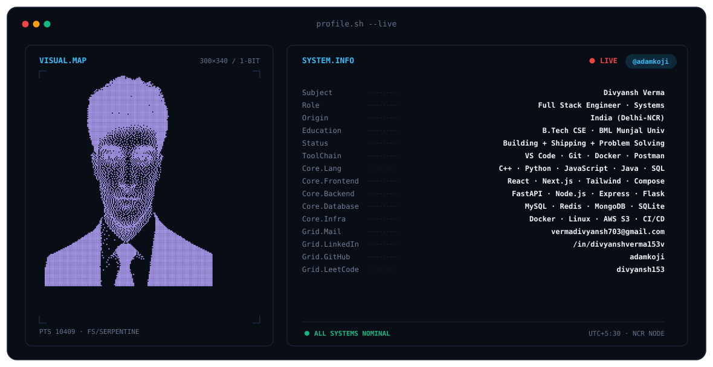

<picture>
  <source media="(prefers-color-scheme: dark)"  srcset="assets/banner-dark.v9.svg">
  <source media="(prefers-color-scheme: light)" srcset="assets/banner-light.v9.svg">
  
</picture>

  

 

&nbsp;&nbsp;
&nbsp;&nbsp;
&nbsp;&nbsp;

  

  # ⚡ Hi there, I'm Divyansh Verma 👋
  
  

  

    
    
    
    
  

---

### 👨‍💻 About Me

- 🎓 **B.Tech in Computer Science & Engineering** from **BML Munjal University** (Batch of 2026).
- 💼 **Former Software Dev Intern** at **Bharti Airtel** (Android Jetpack Compose, MVVM, and low-latency API sync) & **Getting Roots** (Decoupled Full-Stack Web & CMS).
- 🚀 **Core Interests:** Building decoupled web applications, high-throughput microservices, sub-second API optimization, and distributed caching architectures.
- 🛠️ Currently developing **[Torpedo Learning](https://torpedolearning.com/)** (an automated LMS & candidate evaluation platform).
- 💬 Ask me about **React, Node.js, Python, Redis caching, or SQL query optimization**.

---

### 🛠️ Tech Stack & Tools

#### 💻 Languages

  
  
  
  
  
  
  

#### 🌐 Frontend & Mobile

  
  
  
  
  
  

#### ⚙️ Backend & APIs

  
  
  
  
  

#### 🗄️ Databases & Caching

  
  
  
  
  

#### 🚀 DevOps & Development Tools

  
  
  
  
  
  

---

### 📌 Featured Projects

| Project | Tech Stack | Highlights |
| :--- | :--- | :--- |
| **[LLM Semantic Cache](https://github.com/adamkoji/LLM-semantic-cache)** | `FastAPI` `Redis` `ChromaDB` `Docker` `Python` | Reduced expensive LLM inference API calls by **76%** using hybrid exact-match storage and vector similarity search. |
| **[Torpedo Learning](https://torpedolearning.com/)** | `Laravel 11` `Blade` `Hotwire Turbo` `Docker` `SQLite (WAL)` | Multi-role LMS featuring in-browser CodeMirror IDE, sandboxed Docker container code execution, and zero-flicker Turbo transitions. |
| **[Decoupled CMS Portfolio](https://beenutaneja.com/)** | `React 18` `Vite` `Laravel 11` `Filament V3` `REST API` | Headless dynamic portfolio powered by a Filament V3 admin portal, session-gated 2FA (email OTP), and a decoupled client. |
| **[Rail Madad Management](https://github.com/adamkoji/)** | `Python/Flask` `MySQL` `JavaScript` `ML Microservices` | Real-time incident ticketing system with composite B-Tree query indexing and automated ML triage pipelines. |

---

### 📊 GitHub & Problem Solving Stats

  
  

 

  

---

  Designed & Built by <b>Divyansh Verma</b> • Let's connect on <a href="https://linkedin.com/in/divyanshverma153v">LinkedIn</a>

